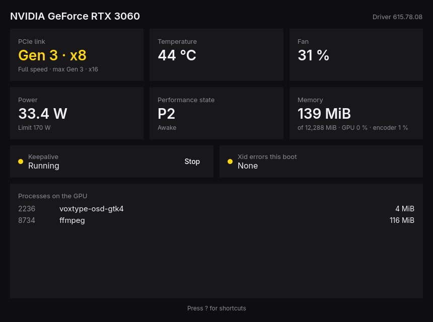

# Nvmon



Watches one NVIDIA GPU on an Omarchy desktop. It answers the questions that
come up when a card keeps falling off the bus: what speed is the PCIe link at,
is the card idle or awake, how hot is it, is the fan turning, and has the
kernel logged an Xid error since boot.

- **PCIe link**: current generation and width against the maximum. It turns
  the accent color at full speed and yellow when the driver has dropped the
  link to its idle speed.
- **Temperature, fan, power, performance state, memory.**
- **Keepalive**: the state of the `rtx-keepalive.service` user unit, which
  holds the card out of its idle state, with a button to start or stop it.
- **Xid errors this boot**, read from the kernel journal.
- **Processes on the GPU.**

It reads everything through `nvidia-smi`, `journalctl`, and `systemctl --user`,
and needs no root. If `nvidia-smi` is missing or the GPU is lost, the window
says so.

## Shortcuts

| Key   | Action                      |
|-------|-----------------------------|
| Space | Start or stop the keepalive |
| R     | Refresh now                 |
| ?     | Show or hide the shortcuts  |
| Q     | Quit                        |

## Build

```sh
bin/build      # build/nvmon
bin/test       # Qt Test, offscreen
bin/install    # makepkg -fsi, adds Nvmon to the app launcher
```

Needs `qt6-base`, `qt6-declarative`, `qt6-wayland`, and `nvidia-utils`, all
part of Omarchy on an NVIDIA machine.

## License

MIT. The theme and translator classes follow Omacut and Monologue by David
Heinemeier Hansson.
